

<picture><source media="(prefers-color-scheme: dark)" srcset="assets/banner-dark.svg"></picture>

          

<picture><source media="(prefers-color-scheme: dark)" srcset="assets/divider-dark.svg"></picture>

<picture><source media="(prefers-color-scheme: dark)" srcset="assets/h-about-dark.svg"></picture>


Hi, I'm **Mayank Shrivastava** from **Sironj, Madhya Pradesh**. I'm an independent developer and creator, and since 2018 I've been building free web tools that people can use without signing up or paying.

Today that means **[ThunderStudy](https://thunderstudy.indevs.in)** and **[ThunderTest](https://thundertest.indevs.in)**, exam-prep platforms for CUET, JEE, NEET, SSC, Banking, CAT and CLAT students, plus a hub of utility tools and creative experiments at **[wondermayank.in](https://wondermayank.in)**. I design everything in my own soft clay UI style and ship fast, usually at midnight, with music on and too many browser tabs open.

<picture><source media="(prefers-color-scheme: dark)" srcset="assets/t-tools-dark.svg"></picture>
<picture><source media="(prefers-color-scheme: dark)" srcset="assets/t-stars-dark.svg"></picture>
<picture><source media="(prefers-color-scheme: dark)" srcset="assets/t-hubs-dark.svg"></picture>

<picture><source media="(prefers-color-scheme: dark)" srcset="assets/a-build-dark.svg"></picture>
<picture><source media="(prefers-color-scheme: dark)" srcset="assets/a-learn-dark.svg"></picture>
<picture><source media="(prefers-color-scheme: dark)" srcset="assets/a-open-dark.svg"></picture>
<picture><source media="(prefers-color-scheme: dark)" srcset="assets/a-ask-dark.svg"></picture>

<picture><source media="(prefers-color-scheme: dark)" srcset="assets/divider-dark.svg"></picture>

<picture><source media="(prefers-color-scheme: dark)" srcset="assets/h-thunder-dark.svg"></picture>

<picture><source media="(prefers-color-scheme: dark)" srcset="assets/bolt-dark.svg"></picture>

The Thunder family is my free exam-prep ecosystem for Indian students. **ThunderStudy** has the notes, PYQs and formulas, **ThunderTest** has the CBT mock tests, **ThunderStudy AI** brings AI chat, mind maps and AI-made mock tests, and **Thunder English** gives fresh English MCQs and one-word practice every day. Around them sit Telegram bots, a daily blog, ThunderDocs and a student community.

<a href="https://thunderstudy.indevs.in"><picture><source media="(prefers-color-scheme: dark)" srcset="assets/th-study-dark.svg"></picture></a>
<a href="https://thundertest.indevs.in"><picture><source media="(prefers-color-scheme: dark)" srcset="assets/th-test-dark.svg"></picture></a>
<a href="https://ai.thunderstudy.indevs.in"><picture><source media="(prefers-color-scheme: dark)" srcset="assets/th-ai-dark.svg"></picture></a>
<a href="https://thunderenglish.indevs.in"><picture><source media="(prefers-color-scheme: dark)" srcset="assets/th-english-dark.svg"></picture></a>
<a href="https://wondermayank.in/bots"><picture><source media="(prefers-color-scheme: dark)" srcset="assets/th-bots-dark.svg"></picture></a>
<a href="https://blog.thunderstudy.indevs.in"><picture><source media="(prefers-color-scheme: dark)" srcset="assets/th-blog-dark.svg"></picture></a>
<a href="https://aipdf.wondermayank.indevs.in"><picture><source media="(prefers-color-scheme: dark)" srcset="assets/th-docs-dark.svg"></picture></a>
<a href="https://t.me/thunderstudy"><picture><source media="(prefers-color-scheme: dark)" srcset="assets/th-tg-dark.svg"></picture></a>

**Exam hubs:** [CUET](https://thundertest.indevs.in/cuet) | [JEE and NEET](https://thundertest.indevs.in/jee-neet) | [SSC](https://thundertest.indevs.in/ssc) | [Banking](https://thundertest.indevs.in/banking) | [CAT](https://thundertest.indevs.in/cat) | [CLAT](https://thundertest.indevs.in/clat) | [NDA](https://thundertest.indevs.in/nda)

<picture><source media="(prefers-color-scheme: dark)" srcset="assets/divider-dark.svg"></picture>

<picture><source media="(prefers-color-scheme: dark)" srcset="assets/h-projects-dark.svg"></picture>

<a href="https://project.wondermayank.in"><picture><source media="(prefers-color-scheme: dark)" srcset="assets/c-hub-dark.svg"></picture></a>
<a href="https://github.com/wondermayank/logos"><picture><source media="(prefers-color-scheme: dark)" srcset="assets/c-logos-dark.svg"></picture></a>
<a href="https://project.wondermayank.in/typing/hindi/hindi_typing"><picture><source media="(prefers-color-scheme: dark)" srcset="assets/c-typing-dark.svg"></picture></a>
<a href="https://project.wondermayank.in/fun/Sign_language"><picture><source media="(prefers-color-scheme: dark)" srcset="assets/c-sign-dark.svg"></picture></a>
<a href="https://body.wondermayank.in"><picture><source media="(prefers-color-scheme: dark)" srcset="assets/c-body-dark.svg"></picture></a>
<a href="https://festival.wondermayank.in"><picture><source media="(prefers-color-scheme: dark)" srcset="assets/c-fest-dark.svg"></picture></a>

<picture><source media="(prefers-color-scheme: dark)" srcset="assets/divider-dark.svg"></picture>

<picture><source media="(prefers-color-scheme: dark)" srcset="assets/h-recent-dark.svg"></picture>

<!-- LATEST-PROJECTS:START -->

<a href="https://github.com/wondermayank/wondercaptions"><picture><source media="(prefers-color-scheme: dark)" srcset="assets/auto/proj-1-dark.svg"></picture></a>
<a href="https://github.com/wondermayank/wonderclip"><picture><source media="(prefers-color-scheme: dark)" srcset="assets/auto/proj-2-dark.svg"></picture></a>
<a href="https://github.com/wondermayank/ncert"><picture><source media="(prefers-color-scheme: dark)" srcset="assets/auto/proj-3-dark.svg"></picture></a>
<a href="https://make.wondermayank.in/"><picture><source media="(prefers-color-scheme: dark)" srcset="assets/auto/proj-4-dark.svg"></picture></a>

<!-- LATEST-PROJECTS:END -->

<picture><source media="(prefers-color-scheme: dark)" srcset="assets/divider-dark.svg"></picture>

<picture><source media="(prefers-color-scheme: dark)" srcset="assets/h-stack-dark.svg"></picture>

<picture><source media="(prefers-color-scheme: dark)" srcset="https://skillicons.dev/icons?i=html%2Ccss%2Cjs%2Ccpp%2Cjava%2Cfirebase%2Ccloudflare%2Cgit%2Cfigma&perline=9&theme=dark"></picture>

<picture><source media="(prefers-color-scheme: dark)" srcset="assets/divider-dark.svg"></picture>

<picture><source media="(prefers-color-scheme: dark)" srcset="assets/h-stats-dark.svg"></picture>

<picture><source media="(prefers-color-scheme: dark)" srcset="assets/auto/stats-dark.svg"></picture>
<picture><source media="(prefers-color-scheme: dark)" srcset="assets/auto/langs-dark.svg"></picture>

<picture><source media="(prefers-color-scheme: dark)" srcset="assets/divider-dark.svg"></picture>

<picture><source media="(prefers-color-scheme: dark)" srcset="assets/h-3d-dark.svg"></picture>

<picture><source media="(prefers-color-scheme: dark)" srcset="profile-3d-contrib/profile-night-view.svg">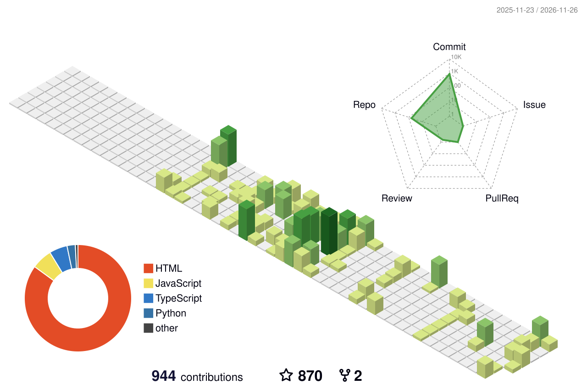</picture>

<picture><source media="(prefers-color-scheme: dark)" srcset="assets/divider-dark.svg"></picture>

<picture><source media="(prefers-color-scheme: dark)" srcset="assets/h-snake-dark.svg"></picture>

<picture><source media="(prefers-color-scheme: dark)" srcset="https://raw.githubusercontent.com/wondermayank/wondermayank/output/github-snake-dark.svg"></picture>

<picture><source media="(prefers-color-scheme: dark)" srcset="assets/divider-dark.svg"></picture>

<picture><source media="(prefers-color-scheme: dark)" srcset="assets/h-status-dark.svg"></picture>

<picture><source media="(prefers-color-scheme: dark)" srcset="assets/auto/status-dark.svg"></picture>

<picture><source media="(prefers-color-scheme: dark)" srcset="assets/divider-dark.svg"></picture>

<picture><source media="(prefers-color-scheme: dark)" srcset="assets/h-posts-dark.svg"></picture>

<!-- BLOG-POST-LIST:START -->- [CUET GAT &amp; Current Affairs Notes For CUET FREE](https://blog.thunderstudy.indevs.in/2026/05/cuet-gat-current-affairs-notes-for-cuet.html) - 8 May 2026- [Accountancy Notes For CUET &lpar;chapterwise&rpar;](https://blog.thunderstudy.indevs.in/2026/05/accountancy-notes-for-cuet-chapterwise.html) - 2 May 2026- [Computer Science Notes For CUET Free](https://blog.thunderstudy.indevs.in/2026/04/computer-science-notes-for-cuet-free.html) - 28 Apr 2026- [Physical Education CUET UG 2026 Notes By Thunder](https://blog.thunderstudy.indevs.in/2026/04/physical-education-cuet-ug-2026-notes.html) - 24 Apr 2026- [English CUET CBT Mock Test Free](https://blog.thunderstudy.indevs.in/2026/03/english-cuet-cbt-mock-test-free.html) - 26 Mar 2026<!-- BLOG-POST-LIST:END -->

<picture><source media="(prefers-color-scheme: dark)" srcset="assets/divider-dark.svg"></picture>

<picture><source media="(prefers-color-scheme: dark)" srcset="assets/h-connect-dark.svg"></picture>

Got an idea, a collaboration, or a file request? Reach me at **[contact@wondermayank.indevs.in](mailto:contact@wondermayank.indevs.in)** or through the [contact page](https://wondermayank.in/contact). Free tools stay free, and your feedback makes them better.

