<picture><source media="(prefers-color-scheme: dark)" srcset="assets/banner-dark.svg"><source media="(prefers-color-scheme: light)" srcset="assets/banner-light.svg"></picture>

         

<picture><source media="(prefers-color-scheme: dark)" srcset="assets/h-about-dark.svg"><source media="(prefers-color-scheme: light)" srcset="assets/h-about-light.svg"></picture>

<table>
<tr>
<td valign="top">

Hi, I'm **Mayank Shrivastava** from **Sironj, Madhya Pradesh**. I'm an independent developer and creator, and since 2018 I've been building free web tools that people can use without signing up or paying.

Today that means **[ThunderStudy](https://thunderstudy.indevs.in)** and **[ThunderTest](https://thundertest.indevs.in)**, exam-prep platforms for CUET, JEE, NEET, SSC, Banking, CAT and CLAT students, plus a hub of utility tools and creative experiments at **[wondermayank.in](https://wondermayank.in)**. I design everything in my own soft clay UI style and ship fast, usually at midnight, with music on and too many browser tabs open.

**Building:** educational platforms, CBT mock tests, student tools and AI study helpers
**Learning:** advanced frontend, full-stack web, AI tools, performance and UI animation
**Open to:** open-source education projects, UI/UX design, SEO, and computer teacher or operator roles
**Ask me about:** web development, GitHub Pages, design systems, branding and creative coding

</td>
<td width="260" align="center" valign="middle">

</td>
</tr>
</table>

<picture><source media="(prefers-color-scheme: dark)" srcset="assets/h-projects-dark.svg"><source media="(prefers-color-scheme: light)" srcset="assets/h-projects-light.svg"></picture>

<table>
<tr>
<td><a href="https://thunderstudy.indevs.in"><picture><source media="(prefers-color-scheme: dark)" srcset="assets/c-study-dark.svg"><source media="(prefers-color-scheme: light)" srcset="assets/c-study-light.svg"></picture></a></td>
<td><a href="https://thundertest.indevs.in"><picture><source media="(prefers-color-scheme: dark)" srcset="assets/c-test-dark.svg"><source media="(prefers-color-scheme: light)" srcset="assets/c-test-light.svg"></picture></a></td>
</tr>
<tr>
<td><a href="https://ai.thunderstudy.indevs.in"><picture><source media="(prefers-color-scheme: dark)" srcset="assets/c-ai-dark.svg"><source media="(prefers-color-scheme: light)" srcset="assets/c-ai-light.svg"></picture></a></td>
<td><a href="https://project.wondermayank.in"><picture><source media="(prefers-color-scheme: dark)" srcset="assets/c-hub-dark.svg"><source media="(prefers-color-scheme: light)" srcset="assets/c-hub-light.svg"></picture></a></td>
</tr>
<tr>
<td><a href="https://github.com/wondermayank/logos"><picture><source media="(prefers-color-scheme: dark)" srcset="assets/c-logos-dark.svg"><source media="(prefers-color-scheme: light)" srcset="assets/c-logos-light.svg"></picture></a></td>
<td><a href="https://project.wondermayank.in/typing/hindi/hindi_typing"><picture><source media="(prefers-color-scheme: dark)" srcset="assets/c-typing-dark.svg"><source media="(prefers-color-scheme: light)" srcset="assets/c-typing-light.svg"></picture></a></td>
</tr>
</table>

**Exam hubs:** [CUET](https://thundertest.indevs.in/cuet) | [JEE and NEET](https://thundertest.indevs.in/jee-neet) | [SSC](https://thundertest.indevs.in/ssc) | [Banking](https://thundertest.indevs.in/banking) | [CAT](https://thundertest.indevs.in/cat) | [CLAT](https://thundertest.indevs.in/clat) | [NDA](https://thundertest.indevs.in/nda)

<picture><source media="(prefers-color-scheme: dark)" srcset="assets/h-stack-dark.svg"><source media="(prefers-color-scheme: light)" srcset="assets/h-stack-light.svg"></picture>

<picture><source media="(prefers-color-scheme: dark)" srcset="https://skillicons.dev/icons?i=html,css,js,vue,cpp,c,java,firebase,supabase,mongodb,mysql,cloudflare,vercel,netlify,gcp,git,github,githubactions,figma,blender,ps,ai,ae,pr&perline=12&theme=dark"></picture>

<picture><source media="(prefers-color-scheme: dark)" srcset="assets/h-stats-dark.svg"><source media="(prefers-color-scheme: light)" srcset="assets/h-stats-light.svg"></picture>

<picture><source media="(prefers-color-scheme: dark)" srcset="https://github-readme-stats.shion.dev/api?username=wondermayank&title_color=B196FB&text_color=C7C0E0&icon_color=9A7AFB&bg_color=221D3C&border_color=2E2650&include_all_commits=true&count_private=true&show_icons=true"></picture>
<picture><source media="(prefers-color-scheme: dark)" srcset="https://github-readme-stats.shion.dev/api/top-langs/?username=wondermayank&title_color=B196FB&text_color=C7C0E0&icon_color=9A7AFB&bg_color=221D3C&border_color=2E2650&include_all_commits=true&count_private=true&layout=compact"></picture>
 
<picture><source media="(prefers-color-scheme: dark)" srcset="https://streak-stats.demolab.com/?user=wondermayank&background=221D3C&ring=9A7AFB&fire=B196FB&currStreakNum=F1EEFB&sideNums=F1EEFB&currStreakLabel=B196FB&sideLabels=C7C0E0&dates=8E86AC&border=2E2650"></picture>

<picture><source media="(prefers-color-scheme: dark)" srcset="assets/h-snake-dark.svg"><source media="(prefers-color-scheme: light)" srcset="assets/h-snake-light.svg"></picture>

<picture><source media="(prefers-color-scheme: dark)" srcset="https://raw.githubusercontent.com/wondermayank/wondermayank/output/github-snake-dark.svg"></picture>

<picture><source media="(prefers-color-scheme: dark)" srcset="assets/h-posts-dark.svg"><source media="(prefers-color-scheme: light)" srcset="assets/h-posts-light.svg"></picture>

<!-- BLOG-POST-LIST:START -->
- [Visit the ThunderStudy blog](https://blog.thunderstudy.indevs.in)
<!-- BLOG-POST-LIST:END -->

<picture><source media="(prefers-color-scheme: dark)" srcset="assets/h-connect-dark.svg"><source media="(prefers-color-scheme: light)" srcset="assets/h-connect-light.svg"></picture>

Got an idea, a collaboration, or a file request? Reach me at **[contact@wondermayank.indevs.in](mailto:contact@wondermayank.indevs.in)** or through the [contact page](https://wondermayank.in/contact). Free tools stay free, and your feedback makes them better.

